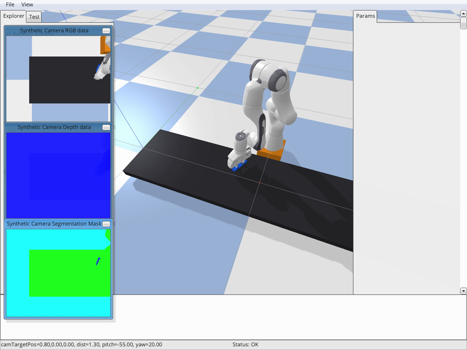
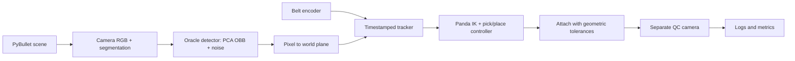

# F1 Assembly — Vision-guided Robotics Capstone

Mô phỏng robot gắp, lắp ráp và kiểm tra chất lượng trên băng chuyền bằng PyBullet. Bài toán liên hệ Vin Robotics/VinFast: kỹ sư tự động hóa cần kiểm chứng phối hợp camera–robot và phát hiện thiếu linh kiện trước khi thử trên dây chuyền thật. Xe F1 thu nhỏ là vật mẫu mô phỏng, không phải mô hình dây chuyền VinFast thực tế.

## Chạy demo

Python 3.10+ (đã chạy với Python 3.11). Chạy mọi lệnh từ thư mục gốc repository:

```bash
python3 -m venv .venv
source .venv/bin/activate  # Windows: .venv\Scripts\activate
python -m pip install -r f1_assembly/requirements.txt
python -m f1_assembly.demo_pick --station 1 --seconds 60 --seed 0
python -m f1_assembly.main --seconds 120 --seed 0
```

Nếu cài PyBullet bằng pip bị lỗi biên dịch trên macOS ARM, dùng gói dựng sẵn từ conda-forge. Môi trường đã dùng để đo trên máy này là `f1sim`, Python 3.11.17, metadata PyBullet 3.2.5 (gói conda 3.25), NumPy 2.4.6:

```bash
conda env create -f environment.yml
conda activate f1sim
python -m f1_assembly.demo_pick --seconds 60 --seed 0
```



Chạy không mở cửa sổ và lưu bằng chứng thực nghiệm:

```bash
python evaluate.py
```

Video dự phòng có sẵn: [demo_pick_tracker.mp4](demo_pick_tracker.mp4). Video minh họa vòng gắp–đặt một tay, không chứng minh cả dây chuyền lắp đủ xe. Xem [báo cáo](REPORT.md), [log thí nghiệm](evidence/) và [kịch bản demo 10 phút](DEMO.md).

Kết quả seed 0: ca một tay 60 giây có 9 lần gắp và 7 lần thả trên 10 linh kiện, sai số dự đoán trung bình 6.6 mm (n=9); khi trượt 20%, sai số tăng lên 24.3 mm (n=6). Ca dây chuyền 120 giây gắn được 4/13 lần thử, chưa có xe đủ sáu bộ phận. Báo cáo phân tích cả các lỗi này và giới hạn của phép đo.

## Kiến trúc và trụ cột Track 4



| Trụ cột | Vị trí trong mã và cách dùng |
|---|---|
| Hình học | `camera.py`: nội/ngoại tham số, tia pixel giao mặt phẳng; `parts.py`: đổi tọa độ slot; `robot.py`: IK Panda |
| Thời gian | `tracker.py`: timestamp ảnh, tích phân encoder và dự đoán pose; `config.py`: physics 240 Hz, điều khiển 60 Hz, camera đầu vào 5 Hz |
| Bất định | `detector.py`: nhiễu tâm 2 px, góc 3 độ, ngưỡng che khuất; `tracker.py`: pha trộn phép đo, xử lý hướng thân xe mơ hồ |
| Biểu diễn | OBB, trạng thái `(s,d,psi)`, track và sáu slot trên thân xe |
| Bằng chứng | `evaluate.py` lưu lệnh, môi trường và log; sai số dự đoán tại thời điểm gắp, kết quả lắp và đối chiếu QC |

**Giới hạn quan trọng:** detector mặc định đọc segmentation và nhãn từ simulator; đây là oracle có nhiễu, không phải model học từ RGB. `YoloDetector` là điểm mở rộng chưa có trọng số được huấn luyện/đánh giá. Cơ chế grasp-assist mặc định giữ vật bằng constraint. Tay chuyển xe số 07 chưa triển khai; QC nằm trên băng chính.

## Tệp chính

- `f1_assembly/`: thế giới vật lý, camera, detector, tracker, robot, assembly, QC.
- `evaluate.py`, `evidence/`: tái lập phép đo và bằng chứng thô.
- `REPORT.md`, `DEMO.md`: giải thích số đo, ca lỗi, tác động và phần trình bày.
- `demo_pick_tracker.mp4`: video dự phòng được cung cấp cùng mã nguồn.

## Nhóm đăng ký

Đội số 3: **HAHAHAHAHAHAHAHAHAHAHAHAHAHA**, đơn vị **Vin Robotics**.

- **Trưởng nhóm: Bùi Đức Thông**.
- **Thành viên: Lê Tuấn Hưng**.

Nguồn danh sách: [bảng theo dõi Capstone, hàng 12–15](https://docs.google.com/spreadsheets/d/1SIAlLnI0hAkd9iOahF4LYF3umY8kNGbkJhNGj62YAio/edit?gid=1696765330#gid=1696765330&range=B12:G15). Hai ô thành viên còn lại đang trống tại thời điểm đối chiếu. GitHub và phân công của thành viên chưa được cung cấp. Đề bài yêu cầu 3–5 người, nên nhóm cần hoàn thiện danh sách với ban tổ chức.

Toàn bộ dữ liệu cảm biến dùng trong thí nghiệm được sinh trong mô phỏng; không có dữ liệu bệnh nhân hay sinh viên.
